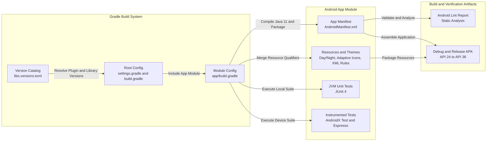

<div align="center">

# Android App 4 (Practical 4)

**Modern Android (Java 11) application workspace configured with Android Gradle Plugin 9.0, Gradle Version Catalogs, Material Day/Night theming, and Android 12+ backup rules.**

[-3DDC84?style=for-the-badge&logo=android&logoColor=white)](https://developer.android.com/)
[](https://openjdk.org/)
[](https://gradle.org/)
[](https://developer.android.com/build)
[](https://m2.material.io/develop/android)
[](LICENSE)

</div>

---

## System & Build Architecture

The repository provides a clean, Gradle-managed Android application scaffold (`com.example.practical_4`) structured around centralized dependency management (`gradle/libs.versions.toml`), non-transitive R classes, Light/Dark theme resource qualifiers, and dual-tier unit and instrumentation test harnesses.



---

## Key Engineering Highlights

- **Centralized Version Catalog (`libs.versions.toml`):** Declares plugins (`AGP 9.0.0`) and dependencies (`AppCompat`, `Material Components`, `JUnit`, `Espresso`) in one strongly typed TOML catalog for reproducible builds.
- **Modern Android SDK Targeting:** Configured for `compileSdk 36` and `targetSdk 36` while maintaining broad backwards compatibility down to `minSdk 24` (Android 7.0 Nougat) with Java 11 source/target bytecode compatibility.
- **Day/Night Material Theming:** Separates default (`values/themes.xml`) and dark mode (`values-night/themes.xml`) palettes inheriting from `Theme.MaterialComponents.DayNight.DarkActionBar`.
- **Adaptive Vector Launcher Assets:** Supplies `mipmap-anydpi-v26` adaptive icon definitions backed by vector foreground/background drawables alongside density-specific WebP launcher fallbacks (`mdpi` through `xxxhdpi`).
- **Android 12+ Privacy & Backup Rules:** Pre-wired with `xml/data_extraction_rules.xml` (cloud backup and device-to-device transfer) and legacy `xml/backup_rules.xml`.
- **Non-Transitive R Classes:** Enables `android.nonTransitiveRClass=true` in `gradle.properties` to keep resource symbols isolated per module and accelerate incremental compilation.

---

## Repository Structure

```text
Android_App_4/
├── app/
│   ├── build.gradle                              # App module config (SDK 24–36, Java 11)
│   ├── proguard-rules.pro                        # R8 / ProGuard shrinking rules
│   └── src/
│       ├── main/
│       │   ├── AndroidManifest.xml               # Application manifest & theme/backup bindings
│       │   └── res/
│       │       ├── drawable/                     # Adaptive launcher foreground & background vectors
│       │       ├── mipmap-*/                     # Adaptive XML & WebP launcher icons
│       │       ├── values/                       # Strings, colors, and Light theme definitions
│       │       ├── values-night/                 # Dark mode theme definitions
│       │       └── xml/                          # Cloud backup & data extraction rules
│       ├── test/java/com/example/practical_4/
│       │   └── ExampleUnitTest.java              # Local JVM JUnit 4 test suite
│       └── androidTest/java/com/example/practical_4/
│           └── ExampleInstrumentedTest.java      # On-device AndroidJUnit4 / Espresso test
├── gradle/
│   ├── libs.versions.toml                        # Centralized Gradle Version Catalog
│   └── wrapper/                                  # Pinned Gradle 9.1.0 wrapper distribution
├── build.gradle                                  # Top-level plugin declaration
├── settings.gradle                               # Repository management & module inclusion
├── gradle.properties                             # JVM heap, AndroidX & non-transitive R flags
├── gradlew / gradlew.bat                         # Cross-platform Gradle wrapper scripts
├── LICENSE                                       # MIT License
└── README.md                                     # Project documentation
```

---

## Getting Started & Local Execution

### Prerequisites

- **JDK 17 or JDK 21** (required to run Gradle 9.1.0; compiles app bytecode to Java 11)
- **Android SDK** with Platform **API 36** installed
- **Android Studio** (optional, for IDE editing and emulator execution)

### 1. Clone the Repository

```bash
git clone https://github.com/theekshana-sudeepa/Android_App_4.git
cd Android_App_4
```

### 2. Configure the Android SDK Path

Ensure `ANDROID_HOME` is exported in your environment, or create a local `local.properties` file at the repository root (already excluded by `.gitignore`):

```properties
sdk.dir=/path/to/your/Android/sdk
```

### 3. Build, Test, and Run Lint

```bash
# Run local JVM unit tests
./gradlew testDebugUnitTest

# Run Android Lint static analysis
./gradlew lintDebug

# Assemble the debug APK
./gradlew assembleDebug

# Run instrumented tests on a connected device or emulator
./gradlew connectedDebugAndroidTest
```

---

## License

This project is licensed under the **MIT License** — see the [LICENSE](LICENSE) file for full details.

---

<div align="center">

**Authored by Theekshana Sudeepa**

[](https://www.linkedin.com/in/theekshana-sudeepa/)
[](https://github.com/theekshana-sudeepa)
[](https://lexoratech.com)

</div>
